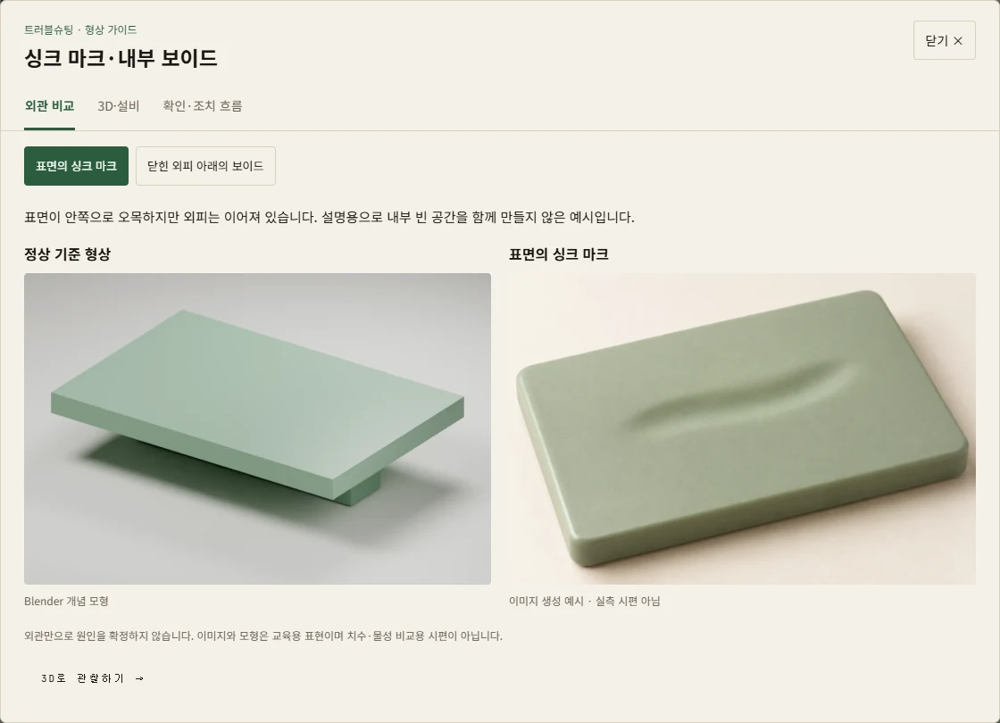
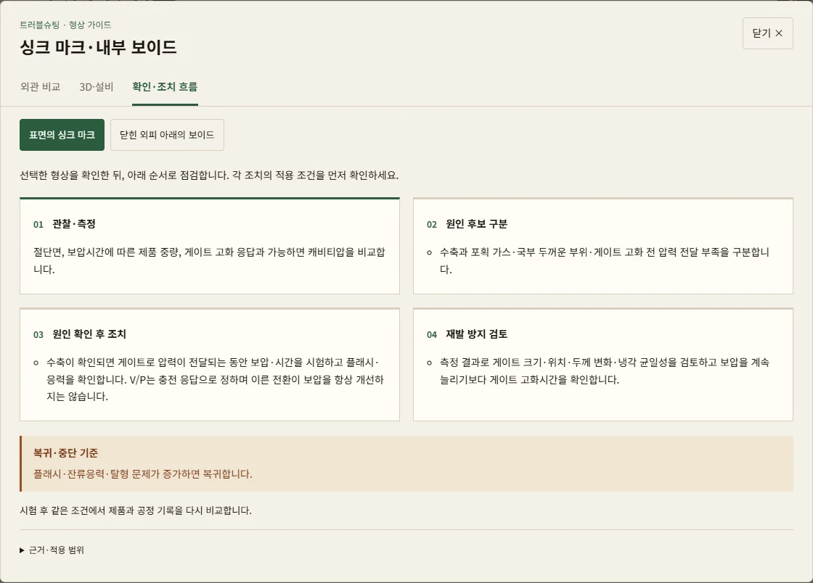
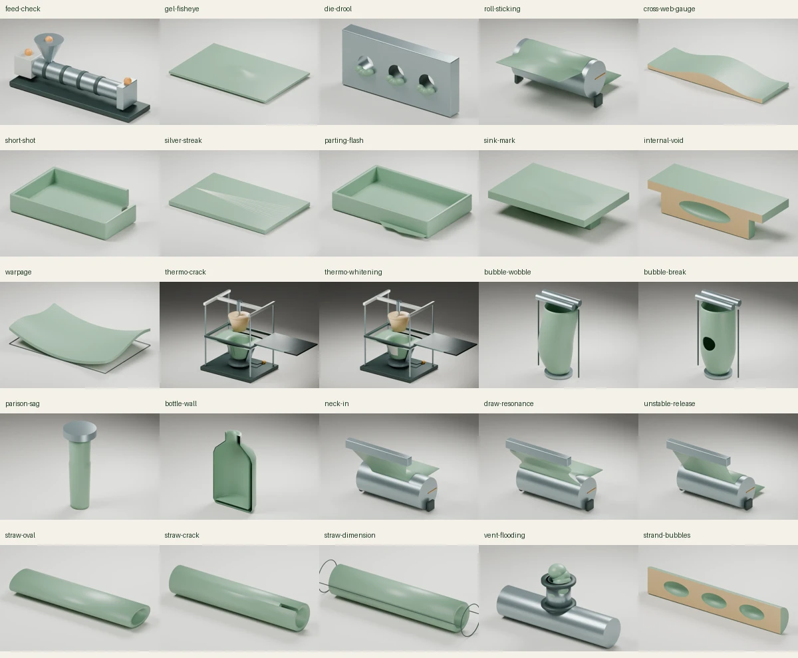

# 트러블슈팅 시각 가이드 제작·검증 — 2026-09-14

16개 점검 항목에 25개 대표 형상을 연결했다. 각 항목에서 **외관 비교 → 3D·설비 → 확인·조치 흐름**을 열 수 있다. 열성형 설비는 이 작업에서 새로 제작했다.

## 사용 경로

데스크톱: **트러블슈팅 → 형상·해결 순서 보기**. 모바일: **더보기 → 트러블슈팅 → 형상·해결 순서 보기**.

- 외관 비교: 정상 기준과 결함 예시를 나란히 비교하고 이미지를 클릭해 확대한다.
- 3D·설비: 회전·확대, 정상 기준 전환, 지원 형상의 단면, 기존 8종 설비 보기를 제공한다. 스트로는 길이 방향 단면과 끝단 시점을 별도로 제공한다.
- 확인·조치 흐름: 관찰·측정 → 원인 후보 구분 → 원인 확인 후 조치 → 재발 방지 검토. 복귀·중단 기준과 원문 근거를 함께 표시한다.
- 움직임이 있는 장면은 재생·일시정지 또는 0–100% 진행 막대로 직접 조작한다. 진행률은 설명용 장면 위치다.





## 제작 범위

| KB 항목 | 대표 형상 | 연결 설비 | 단면 |
|---|---|---|---|
| pha-kb-1 | 공급·구동·하류 점검 위치 | 컴파운딩 | 외관 |
| pha-kb-2 | 덩어리 결점·피시아이 | 컴파운딩 | 지원 |
| pha-kb-3 | 다이 립 침적 | 압출 | 외관 |
| pha-kb-4 | 롤에서 떨어지지 않는 시트 | 시트 | 외관 |
| pha-kb-5 | 폭 방향 두께 차이 | 시트 | 지원 |
| pha-kb-6 | 끝까지 채워지지 않은 성형품 | 사출 | 외관 |
| pha-kb-7 | 흐름 방향의 은색 줄 | 사출 | 외관 |
| pha-kb-8 | 파팅라인 밖의 얇은 막 | 사출 | 외관 |
| pha-kb-9 | 표면의 싱크 마크 / 닫힌 외피 아래의 보이드 | 사출 | 지원 |
| pha-kb-10 | 기준 평면에서 벗어난 휨 | 사출 | 외관 |
| pha-kb-11 | 열성형 벽면 균열 / 열성형 국부 백화 | **신규 열성형 설비** | 외관 |
| pha-kb-12 | 버블 중심 흔들림 / 버블의 국부 파단 | 블로운 필름 | 외관 |
| pha-kb-13 | 대기 중 패리슨 처짐 / 용기 벽 두께 불균일 | 블로우 성형 | 지원 |
| pha-kb-14 | 다이 아래의 폭 수축 / 반복되는 폭·두께 변화 / 칠롤 박리 경로 불안정 | 캐스트 필름 | 외관 |
| pha-kb-15 | 스트로 타원 단면 / 절단면에서 시작된 균열 / 보관 전후 치수 변화 | 스트로 | 지원 |
| pha-kb-16 | 벤트로 올라온 용융물 / 스트랜드 내부 빈 공간 | 컴파운딩 | 지원 |

편집 가능한 Blender 원본 16개와 웹 GLB 16개에 정상·결함·단면 상태 56개를 넣었다. 별도의 이미지 생성 예시는 8장이다. 피시아이, 미충전, 은색 줄, 열성형 균열·백화, 스트로 균열 6장을 새로 생성하고 기존 싱크·플래시 예시 2장을 재사용했다.

웹 자산은 GLB 16개 + 형상 포스터 56장 + 생성 예시 8장 + 썸네일 16장 = **96개, 6,824,918 bytes**다. 데이터/목록 파일을 포함한 새 시각자료 서비스 워커 목록은 98개다. 원본 PNG와 `.blend`는 배포하지 않는다.



## 신규 열성형 모형

새 프레임, 가열 캐리지, 클램프 4개, 암형 금형의 관찰용 절개, 진공 연결부, 플러그·액추에이터·연결 로드, 성형 시트를 제작했다. 시트의 실제 GLB morph target과 부품 좌표를 조작한다.

| 장면 진행률 | 관찰 동작 |
|---|---|
| 0–20% | 시트 고정·가열 준비, 히터 이동 시작 |
| 20–55% | 히터 이탈, 플러그 하강과 시트 성형 |
| 55–76% | 진공 성형·냉각 유지의 개념 장면 |
| 76–93% | 플러그·로드 복귀, 클램프 개방 |
| 93–100% | 이형과 성형품 상승 |

이 비율은 재생 구간이며 실제 사이클 시간·온도·진공압 설정값이 아니다. 변형은 설명용이고 열전달, 진공 유동, 두께 분포, 결정화, 응력·균열 발생을 계산하지 않는다. 시트는 얇은 표면 모형이며 두께 예측 결과가 아니다. 모형은 특정 제조사 설비의 복제 도면이 아니다.

구성·공정 순서의 참고는 [Formech 진공성형 교육 가이드](https://www.formech.com/assets/pdf/Vacuum-Forming-Guide-for-the-Classroom-Aug-24-v1.pdf), [플러그 보조 성형 설명](https://eu.formech.com/blog/n), [HD750 설비 구성](https://eu.formech.com/product/formech-hd750-vacuum-former)이다. 이 자료의 온도·시간 등을 PHA 생산 추천값으로 옮기지 않았다. PHA 진단과 조건부 조치는 기존 검토 KB를 사용한다.

## 근거·표현 검수

공정 조건과 조치 내용은 기존 **2026-09-06-all-processing** KB와 연결했다. `data/troubleshooting_kb.json`의 `related_images` 외 필드는 작업 시작 커밋과 동일함을 비교했다. 이번 작업에서 새로운 GPT Pro 조사나 공정 설정값 검증을 수행했다고 주장하지 않는다. 이전 GPT-6 Pro 완료 조사와 제조사 원문 대조 기록은 [전체 가공 검토](ALL_PROCESSING_REVIEW_20260906.md)를 따른다.

싱크는 표면 함몰, 보이드는 닫힌 외피 아래 내부 공간으로 구분했다. 스트랜드 내부 기포와 스트로의 정상 중공도 다르게 모델링했다. 균열·백화는 관찰 형상이며 그 자체로 원인을 확정하지 않는다. 토크·압력 점검 항목은 결함 사진으로 확정할 수 없으므로 점검 위치도로 표현했다.

[Claude 한영 용어 검수](research/claude-troubleshooting-visual-terms-20260914.md)에 새 25개 형상의 제목·설명만 전달했다. 패리슨 처짐의 해석 범위, 고화/solidification, 백화 시점, 변형 크기의 과장 표현 등을 반영했다. 원본 공정 조치와 수치는 변경하지 않았다.

이미지에는 생성 예시, Blender 그림에는 개념 모형 표시를 붙였다. 생성 프롬프트와 원본은 `art/troubleshooting/image-prompts.json`, `sink-image-prompt.txt`, `images/`에 보존한다. 기존 플래시의 제작 기록은 [시각자료 기록](VISUAL_ASSETS_20260906.md)에 있다. 각 웹 자산의 SHA-256·크기·생성 원본 연결은 `assets/troubleshooting/manifest.json`에 기록한다.

## 구현과 유지보수

| 경로 | 역할 |
|---|---|
| `data/troubleshooting_visuals.json` | KB ID, 25개 형상, 한영 설명, 정상/단면 상태, 자산 연결 |
| `troubleshooting-visuals-data.js` | 동일한 오프라인 데이터 |
| `troubleshooting-visuals.js` / `.css` | 공유 확대창, 이미지 확대, 확인·조치 흐름, 접근성·모바일 표시 |
| `troubleshooting-viewer.js` | 클릭 시 로드되는 Three.js 뷰어, 실제 GLB 부품·morph 조작, 자원 해제 |
| `troubleshooting-visuals-sw.js` | 생성된 웹 자산 캐시 목록 |
| `art/troubleshooting/` | 편집 원본·제작 프롬프트·모형별 상태 목록 |
| `scripts/create_troubleshooting_models.py` | Blender 모형과 렌더 생성 |
| `scripts/pack_troubleshooting_assets.py` | WebP 변환·축소, 썸네일, 자산 해시, 25개 검토 그림 |
| `scripts/sync-troubleshooting-visuals.cjs` | JSON/JS/캐시 목록·KB 연결 동기화 및 검사 |

시각 흐름은 KB 원문에서 바로 렌더링한다. 검토 버전과 선택된 KB 내용의 FNV-1a fingerprint가 달라지면 오래된 조치 흐름을 차단한다. 이 값은 내용 동기화 검사이며 보안 서명이 아니다. KB 내용을 수정할 때는 근거 검토 후 동기화하고, 정적 웹 파일이 바뀌면 캐시 버전도 갱신한다.

새 창은 항상 일시정지로 시작한다. 닫기·숨김·다른 탭·동작 줄이기 설정 변화 시 재생을 중단한다. 뷰어를 닫거나 모형을 교체할 때 요청을 취소하고 GPU 자원을 해제한다. WebGL·GLB·동적 모듈 로딩 실패 시 그림과 KB 안내를 유지한다. 로컬 Three.js와 서비스 워커 `pha-cache-v22-troubleshooting-visuals`를 사용하며 사용자 저장 기록을 삭제하지 않는다.

모바일 ‘더보기’는 모든 이미지의 load 이벤트를 기다리던 문제를 수정했다. DOM이 준비되면 바로 작동하고 `aria-expanded`가 실제 상태를 따른다. 증상 검색 시 일치한 항목의 진단 본문도 펼쳐진다. 320px 영문 탭은 줄바꿈을 허용하며 확대창은 화면 가운데에 맞춘다.

## 재생성

프로젝트 루트에서 실행한다. Blender 5.2.1 LTS, Python/Pillow 11.1.0, Node 22.16, 저장소의 Playwright와 로컬 Three.js 0.185.1을 사용했다. 추가 설치는 필요하지 않았다.

```powershell
$phaBlender = 'C:\Program Files\Blender Foundation\Blender 5.2\blender.exe'
& $phaBlender --background --factory-startup --python-exit-code 1 --python scripts/create_troubleshooting_models.py
python scripts/pack_troubleshooting_assets.py
node scripts/sync-troubleshooting-visuals.cjs
& $phaBlender --background --factory-startup --python-exit-code 1 --python tests/blender-troubleshooting-models.py
npm run check:kb
npm run check:ts-visuals
npm run test:ts-visuals
npm run build
$env:PHA_TEST_ROOT = 'dist'
node tests/troubleshooting-visuals.mjs
Remove-Item Env:PHA_TEST_ROOT
```

특정 모형만 다시 만들려면 Blender 생성 명령 끝에 `-- thermoforming`처럼 family 이름을 붙인다. 최초 전체 생성 후 전체 포스터를 패키징한다. 원본 점검 스크립트는 편집 파일을 유용한 초기 시점으로 저장한다. 중간 렌더·개별 브라우저 캡처·이전 검토 시안은 `output/`의 해당 작업 폴더에 유지하고 Git에서 제외했다.

## 검증 기록

검증은 독립 브라우저와 실행 후 종료되는 로컬 HTTP 서버에서 수행한다. 측정 데이터나 사용자 브라우저의 API 키를 사용하지 않는다.

- [Blender 형상 검사](verification/troubleshooting-geometry.json): 16개 모형군, 56개 상태, 유한 좌표, 닫힌 보이드 외피, 스트로 중공·균열과 열성형 제어 부품.
- [소스 브라우저 검사](verification/troubleshooting-ui.json): 25개 모형·정상·단면, 열성형 실제 노드 이동과 시트 변형, 조작·정지·키보드, 한영·검색·모바일·오프라인·실패 상태.
- [배포 파일 브라우저 검사](verification/troubleshooting-ui-dist.json): 같은 검사를 `dist/`에 적용한다.
- [기존 8종 설비 연결 검사](verification/troubleshooting-equipment-contexts.json): 공유 뷰어에서 사출·압출·시트·필름·블로우·컴파운딩·스트로 원본을 불러와 단계 이동한다.
- [기존 기능 회귀 검사](verification/troubleshooting-regressions.json): 공정 조건·계산·기록·My AI, 기존 사출 및 7개 라인의 조작, Unreal 이미지와 회전수·속도 계산.

| 검증 | 결과 |
|---|---|
| Blender 원본 | 16개 모형군·56개 상태 통과 |
| 시각자료 정적 검사 | 5개 테스트 통과; 자산 해시·GLB 상태·페이로드 한도·오프라인 목록 |
| 새 시각 가이드 브라우저 | 소스 9개 / dist 9개 검사군 통과 |
| 기존 공정 UI | 소스 22개 / dist 22개 검사군 통과 |
| 기존 사출 / 7개 라인 / Unreal·운동 계산 UI | 12개 / 12개 / 13개 검사군 통과 |
| 공정 근거·KB / 운동 계산 | 9개 / 4개 테스트 통과 |
| My AI | 기존 회귀 스모크 통과 |
| KB·자산 동기화 | 16개 KB·25개 형상·98개 URL 일치 |
| 배포 빌드 | 성공; UI 소스와 바이트 일치, `.blend`·`art/` 제외 |

열성형에서는 플러그가 컵 바닥을 관통하지 않는지 8개 중간 단계에서 확인했다. 데스크톱 키보드와 모바일 터치로 실제 진행 막대를 움직였으며, 390px·320px 한영 화면의 가로 넘침, 실제 ‘더보기’ 진입, 모형 로딩 실패 3종과 오프라인 재실행을 확인했다. 이는 교육용 모형과 UI의 검증이며 PHA 실제 공정의 수치 예측 검증이 아니다.

[열성형 조작 화면](verification/troubleshooting-thermoforming-controls.webp) / [390px 모바일](verification/troubleshooting-mobile-390.webp) / [320px 영문](verification/troubleshooting-mobile-en-320.webp).

검사 결과와 배포 산출물은 로컬 재현 검증이다. 공개 운영 사이트의 반영 여부는 Git 푸시와 별도로 확인해야 한다.
